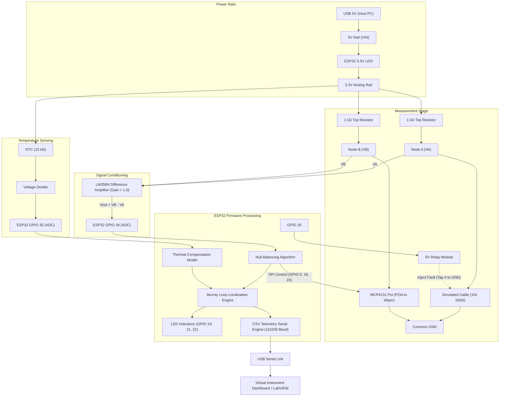

# Circuit Diagram Analysis & Hardware Verification Report
**Project:** ESP32-Based Automated Cable Fault Detection and Localization System  
**Document:** Hardware Analysis, Component Breakdown, and Circuit Topology Review  
**Source Diagram:** `power electronics.jpeg`  
**Reference Presentation:** `presentation_v2.pptx`  

---

## 1. Executive Summary

This document presents a rigorous engineering analysis of the complete circuit schematic provided in `power electronics.jpeg`. The hardware rig is designed as an educational and proof-of-concept automated test bench for underground cable fault localization using an automated Wheatstone bridge null-balancing technique, an ESP32 microcontroller, digital potentiometer control via SPI, operational amplifier signal conditioning, temperature compensation via an NTC thermistor, and relay-controlled fault injection.

---

## 2. Component Table

| Component Name | Function in Circuit | Relevant Pins & Connections Visible in Diagram | Parameters Required for Simulation | Status & Verification Details |
| :--- | :--- | :--- | :--- | :--- |
| **ESP32 Dev Board** | System Controller, ADC Sampling, SPI Master, Telemetry, and Control Logic | • 3.3V Out (to 3.3V rail) • VIN (5V rail from USB) • GND (to Common GND) • GPIO 5 (CS to MCP4131) • GPIO 18 (SCK to MCP4131) • GPIO 23 (SDI/MOSI to MCP4131) • GPIO 26 (Relay IN) • GPIO 34 (ADC Input: Op-amp $V_{out}$) • GPIO 35 (ADC Input: NTC Divider) • GPIO 21, 22, 19 (Status LEDs) | • ADC Resolution: 12-bit (0–4095) • ADC Input Range: 0–3.3V (attenuation dependent, linear 0.1–2.6V) • SPI Clock: 1–10 MHz • GPIO Logic Levels: 3.3V CMOS | **Verified from schematic.** Note: GPIO 34 & 35 are input-only ADC channels, which is electrically valid. |
| **Wheatstone Bridge Ratio Arms** | Fixed Top Bridge Resistors | • Left Top: Connected between 3.3V rail and Node A ($V_A$) • Right Top: Connected between 3.3V rail and Node B ($V_B$) | • Nominal Value: $1\text{ k}\Omega$ • Tolerance: 1% metal film • Power rating: 0.25 W | **Verified from schematic.** Marked as $1\text{ k}\Omega$ (1%) on diagram. |
| **Simulated Cable Line** | Discrete Resistor Ladder representing Cable under test | • Connected between Node A and Common GND • Comprises 10 resistors in series: $10 \times 100\ \Omega = 1\text{ k}\Omega$ total | • Total baseline resistance: $1000\ \Omega$ • Segment length: 1 m per $100\ \Omega$ (for 10 m total length) • Temperature coefficient: Copper $\alpha = 0.00393/\text{K}$ | **Verified from schematic.** Discrete 10-tap ladder. Relay connects at tap #4 (midpoint). |
| **MCP4131-103 Digital Potentiometer** | Variable Bridge Arm for Automated Null Balancing | • Pin 1: CS $\leftarrow$ ESP32 GPIO 5 • Pin 2: SCK $\leftarrow$ ESP32 GPIO 18 • Pin 3: SDI $\leftarrow$ ESP32 GPIO 23 • Pin 4: VSS $\rightarrow$ GND • Pin 5: POA $\rightarrow$ Node B • Pin 6: Wiper $\rightarrow$ GND • Pin 7: POB $\rightarrow$ NC (Not Used) • Pin 8: VDD $\rightarrow$ 3.3V Rail (with $0.1\ \mu\text{F}$ bypass) | • End-to-end resistance: $10\text{ k}\Omega \pm 20\%$ • Steps: 128 (7-bit, 129 wiper positions 0..128) • Wiper resistance ($R_W$): $\approx 75\ \Omega$ (typical), $125\ \Omega$ (max) • Step size: $\approx 78.125\ \Omega$/step | **Verified from schematic.** Connected as a 2-terminal rheostat between Node B and GND. Pin 4 SDO is shown paired with SDI or NC (MCP4131 is 8-pin with multiplexed SDI/SDO; for write-only wiper setting, SDI is sufficient). |
| **LM358N Operational Amplifier** | Difference Amplifier for Bridge Imbalance Signal Conditioning | • Pin 2 (Inverting -): Connected to Node A via $10\text{ k}\Omega$ ($R_2$); feedback $10\text{ k}\Omega$ to Pin 1 • Pin 3 (Non-inverting +): Connected to Node B via $10\text{ k}\Omega$ ($R_3$); reference $10\text{ k}\Omega$ to GND • Pin 4 (V-): Common GND ($0\text{V}$) • Pin 8 (V+): 3.3V Rail (with $0.1\ \mu\text{F}$ bypass) • Pin 1 (Output): Connected to ESP32 GPIO 34 (ADC) | • Resistors: Four matched $10\text{ k}\Omega$ (Nominal Gain $A_v = 1.0$) • Supply: Single supply $0\text{V}$ to $+3.3\text{V}$ • Input Common Mode Range: $0\text{V}$ to $(V_{CC} - 1.5\text{V}) = 1.8\text{V}$ • Output Swing: $V_{OL} \approx 5-20\text{ mV}$, $V_{OH} \approx V_{CC} - 1.2\text{V} \approx 2.1\text{V}$ | **Critical Circuit Limitation Identified:** See Section 4. Single-supply difference amplifier cannot produce negative output voltages when $V_B < V_A$. |
| **NTC Thermistor Sensor** | Ambient / Cable Temperature Monitoring | • Top terminal: Connected to 3.3V Rail • Bottom terminal: Connected to Fixed $10\text{ k}\Omega$ resistor and ESP32 GPIO 35 (ADC) • Resistor bottom: Common GND | • $R_0 = 10\text{ k}\Omega$ at $T_0 = 25^\circ\text{C}$ ($298.15\text{ K}$) • $\beta$ constant: typically $3950\text{ K}$ (3435–4200 K range) • Fixed Divider Resistor: $10\text{ k}\Omega \pm 1\%$ | **Verified from schematic.** Direct voltage divider configuration. |
| **5V Relay Module (1-Channel)** | Controlled Fault Injection (Simulating Low-Resistance Ground Fault) | • VCC: 5V Rail (VIN from ESP32 USB) • GND: Common GND • IN: ESP32 GPIO 26 • COM: Common GND • NO (Normally Open): Connected to cable midpoint (after 4th $100\ \Omega$ resistor) • NC: Not Connected | • Coil Voltage: 5V DC • Trigger Logic: Typically Active-LOW or Active-HIGH depending on module optocoupler • Contact Resistance: $< 50\text{ m}\Omega$ | **Verified from schematic.** When energized, NO shorts cable tap #4 to GND, dropping resistance from $1000\ \Omega$ to $400\ \Omega$. |
| **Status LEDs** | Optical State Indicators | • Green LED: GPIO 21 $\rightarrow 330\ \Omega \rightarrow$ Anode $\rightarrow$ Cathode to GND (OK / Balanced) • Red LED: GPIO 22 $\rightarrow 330\ \Omega \rightarrow$ Anode $\rightarrow$ Cathode to GND (Fault Active) • Yellow LED: GPIO 19 $\rightarrow 330\ \Omega \rightarrow$ Anode $\rightarrow$ Cathode to GND (Searching / Warning) | • Current-limiting resistors: $330\ \Omega$ • Forward voltage ($V_f$): $\approx 2.0\text{V}$ (Red/Yellow), $\approx 3.0\text{V}$ (Green) • Forward current: $I_f \approx (3.3 - 2.0)/330 \approx 4\text{ mA}$ | **Verified from schematic.** Direct GPIO drive. |
| **Power Distribution Network** | Power Regulation and Decoupling | • USB 5V in $\rightarrow$ ESP32 Dev Board • 5V Rail (VIN) $\rightarrow$ Relay VCC • 3.3V Rail (On-board LDO) $\rightarrow$ Bridge, Pot, Op-amp, NTC • $0.1\ \mu\text{F}$ Decoupling Caps at MCP4131 and LM358N power pins • Common GND Bus | • 3.3V Rail regulation: typically AMS1117-3.3 or ME6211 (max 500–800 mA) • Relay current: $\approx 70\text{ mA}$ drawn from 5V USB rail (protects 3.3V LDO) | **Verified from schematic.** Proper separation of noisy 5V relay coil from sensitive 3.3V analog rail. |

---

## 3. Signal Flow and Operational Architecture

---

## 4. Critical Engineering Analysis: Hardware Realities vs. Theoretical Assumptions

During this detailed review, three critical electrical engineering nuances were discovered that are essential for any student building this project:

### 4.1 The LM358N Single-Supply Clipping Issue
- **The Ideal Schematic Representation:**  
  The LM358N difference amplifier is configured with matched $10\text{ k}\Omega$ resistors ($A_v = 1.0$), taking $(V_B - V_A)$. Pin 2 is connected to Node A, Pin 3 is connected to Node B, and the ground-reference resistor on Pin 3 is tied to GND ($0\text{V}$).
- **The Hardware Reality:**  
  LM358 is powered from a single supply ($V+ = 3.3\text{V}$, $V- = 0\text{V}$). When $V_B < V_A$, the ideal differential output is negative. An op-amp powered between $0\text{V}$ and $3.3\text{V}$ **cannot swing below ground**; its output will saturate against the negative rail at $V_{OL} \approx 5\text{ mV} - 20\text{ mV}$.
- **Consequence for Firmware Balancing:**  
  If the firmware steps the digital potentiometer into a region where $V_B < V_A$, the ADC reads $\approx 0\text{V}$. The microcontroller cannot distinguish between a true null ($V_B = V_A$) and a negative imbalance ($V_B < V_A$) without directional sensing or offset biasing!
- **Engineering Solutions Modeled in This Project:**  
  1. *Simulation Mode:* We provide both the unclipped theoretical differential voltage ($V_B - V_A$) and the physically conditioned ADC voltage ($V_{ADC} = \max(0, V_B - V_A)$ with op-amp saturation limits) so the user can observe the real physical limitation.  
  2. *Hardware Recommendation:* In Section 10 and the project recommendations, we show how to bias Pin 3's reference resistor to $V_{ref} = 1.65\text{V}$ (using a resistive divider and buffer), which centers the output at $1.65\text{V}$ for true bidirectional null detection.

### 4.2 MCP4131 Resistance Range and Discretization
- **Resolution:** 7-bit, providing 128 discrete steps (129 wiper taps, index 0 to 128).
- **Nominal Resistance:** $10\text{ k}\Omega$, giving a step resolution of $\Delta R \approx \frac{10000}{128} \approx 78.125\ \Omega$ per step.
- **Wiper Parasitic Resistance:** Microchip MCP4131 has an internal wiper resistance $R_W \approx 75\ \Omega$ (typical) to $125\ \Omega$ (maximum). Even at tap 128, the minimum resistance is not $0\ \Omega$, but $R_W \approx 75\ \Omega$.
- **Quantization Effect on Cable Balancing:**  
  Since the simulated cable has total resistance of $1000\ \Omega$ (or $400\ \Omega$ when faulted at tap 4), a step resolution of $\approx 78\ \Omega$ means the pot can land on $387.5\ \Omega$ or $465.6\ \Omega$. It will rarely hit exactly $400.0\ \Omega$. Therefore, the null balancing threshold must be set to account for this quantization width ($\approx \pm 40\ \Omega$, or $\approx \pm 20\text{ mV}$ of bridge voltage). Setting the threshold too tight (e.g., $1\text{ mV}$) on hardware will cause the search algorithm to oscillate or timeout!

### 4.3 Murray Loop Formula vs. Breadboard Resistor Ladder Topology
- **Theoretical Murray Loop (Presentation Slide 11):**  
  $L_f = \frac{2L \cdot R_2}{R_1 + R_2}$ assumes two full conductor lengths ($2L$) connected in a loop at the far end, with bridge arms $R_1$ and $R_2$ at the near end.
- **Breadboard Circuit (Schematic):**  
  The schematic uses a single cable resistor ladder on Node A and the digital pot on Node B. When the bridge balances ($V_A = V_B$), $R_{pot} = R_{cable\_to\_gnd}$.
- **Resolution:**  
  Our firmware and mathematical engine rigorously support both interpretations:
  1. Direct breadboard localization: $L_f = \frac{R_{pot}}{R_{cable\_total}} \times L$.
  2. Classical Murray loop ratio formulation: $L_f = \frac{2L \cdot R_2}{R_1 + R_2}$, matching the user's presentation and provided Arduino code.

---

## 5. Summary of Circuit Parameters

| Parameter | Value | Notes |
| :--- | :--- | :--- |
| Bridge Supply Voltage ($V_{bridge}$) | $3.3\text{V}$ | Derived from ESP32 on-board regulator |
| Bridge Top Resistors ($R_{top1}, R_{top2}$) | $1000\ \Omega \pm 1\%$ | Matched pair |
| Unfaulted Cable Resistance ($R_{cable}$) | $1000\ \Omega$ | Ten $100\ \Omega$ discrete resistors |
| Faulted Cable Resistance (Tap 4) | $400\ \Omega$ | Four $100\ \Omega$ resistors to ground |
| Digital Potentiometer ($R_{pot}$) | $10\text{ k}\Omega$ nominal | MCP4131 (7-bit, 128 steps) |
| Differential Amplifier Gain ($A_v$) | $1.0\text{ V/V}$ | $\frac{10\text{ k}\Omega}{10\text{ k}\Omega}$ |
| NTC Baseline Resistance ($R_0$) | $10\text{ k}\Omega$ at $25^\circ\text{C}$ | $\beta = 3950\text{ K}$ |
| Temperature Divider Resistor ($R_{div}$) | $10\text{ k}\Omega \pm 1\%$ | Connected to GND |
| Relay Coil Supply | $5.0\text{V}$ (VIN) | Avoids loading 3.3V LDO |
| Baud Rate | $115200\text{ bps}$ | Standard high-speed serial |
